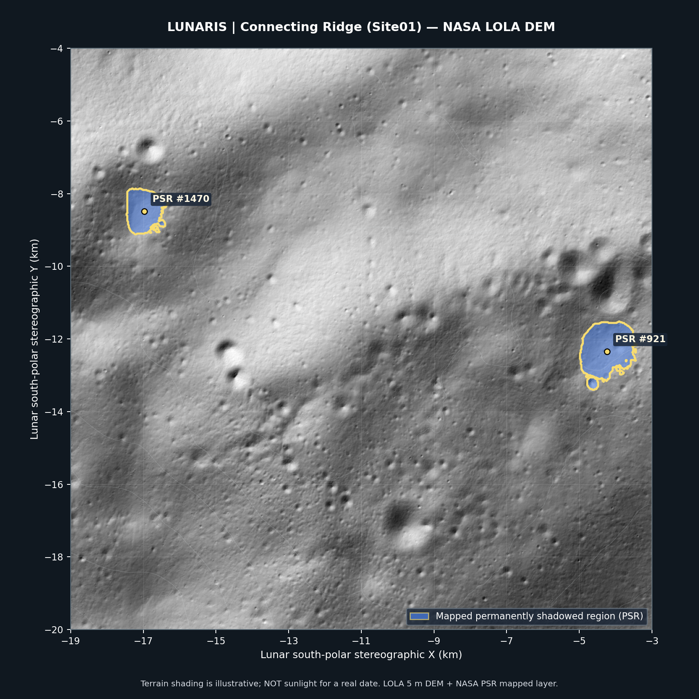
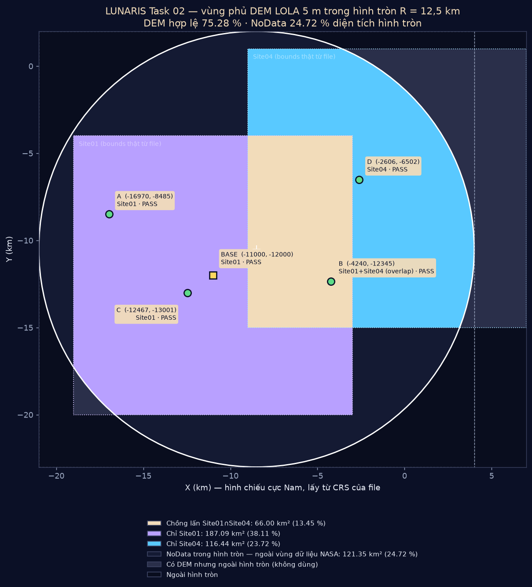
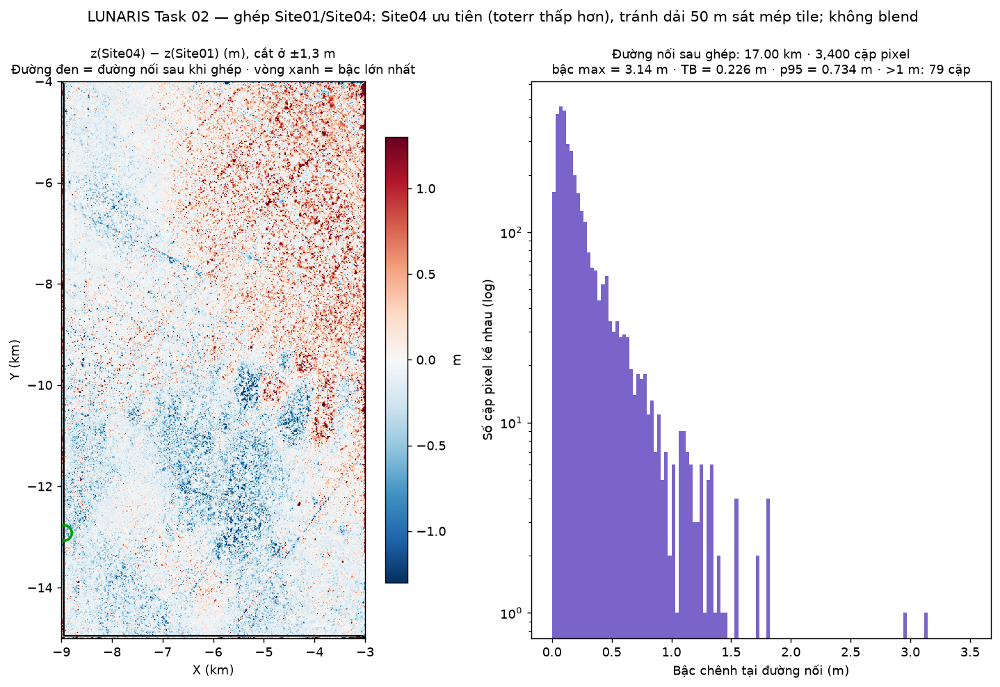
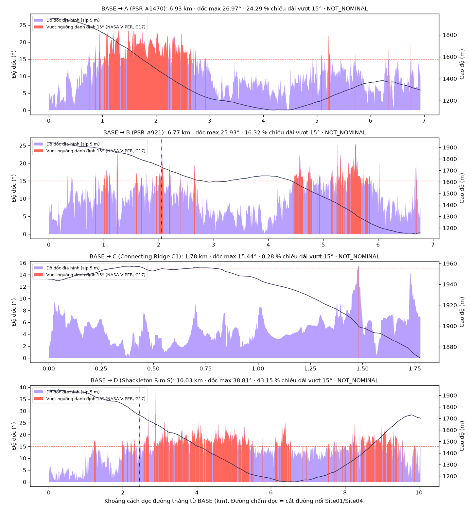
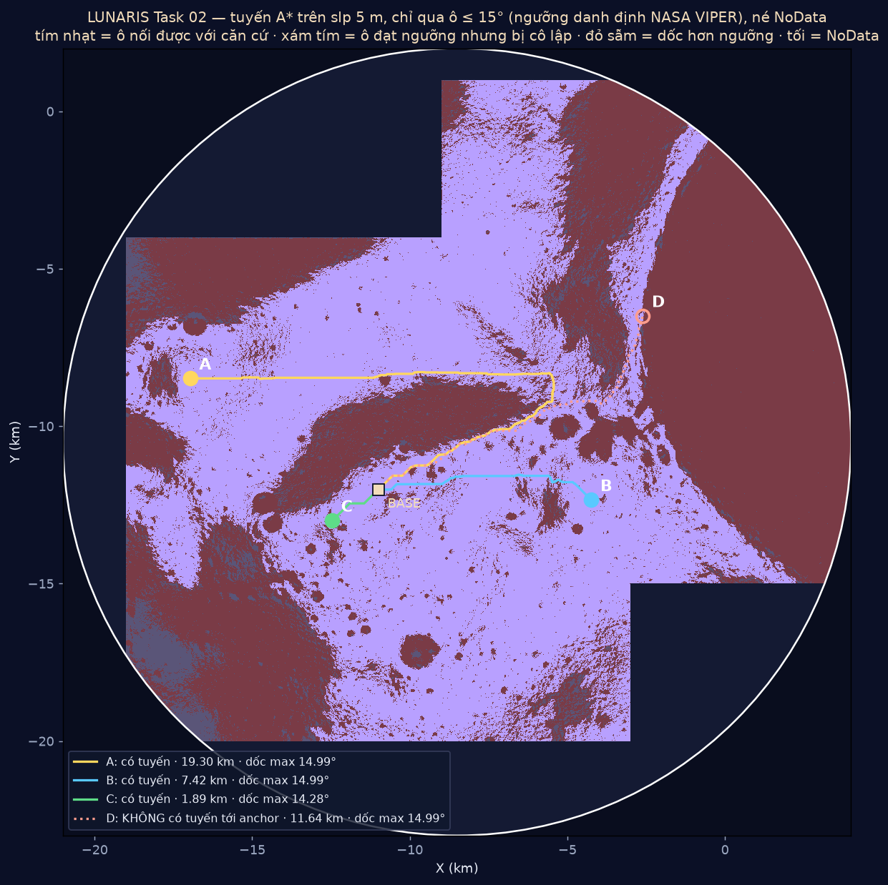
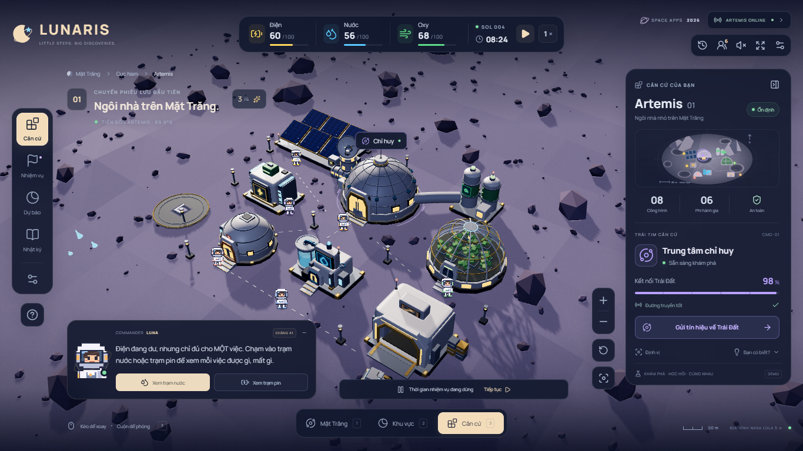
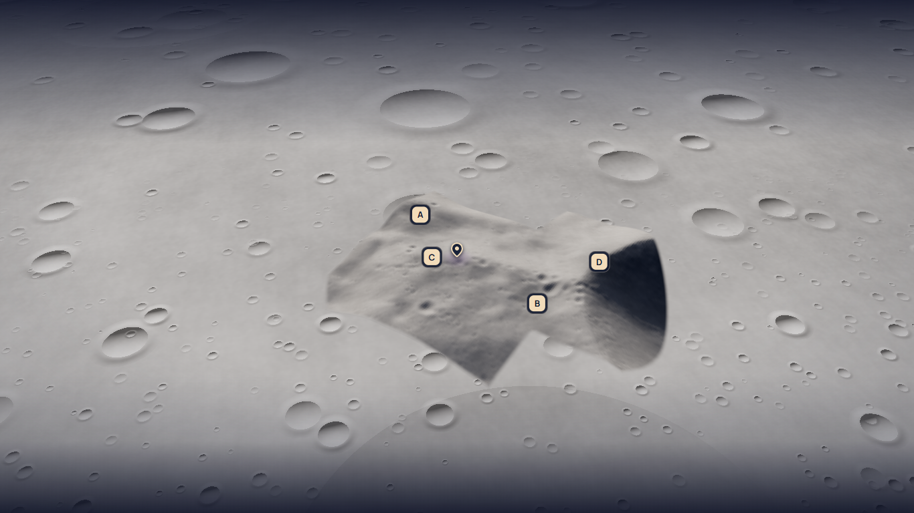
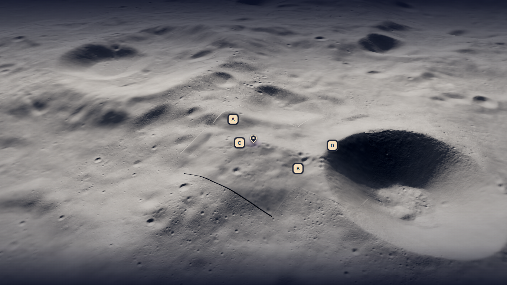

# LUNARIS — EVIDENCE.md

**Hồ sơ kiểm chứng khoa học, địa hình và định lượng cho ban giám khảo**  
**Cập nhật khởi tạo:** 14/11/2026 (ICT). **Cập nhật gần nhất:** 15/11/2026 ICT (SEAM-01, xem §8). **Phạm vi:** Story Mode v0.9, Task 02 FINAL, kết quả GIS do người dùng báo cáo ngày 14/11/2026.  
**Trạng thái:** `WORKING_EVIDENCE` — tài liệu dẫn nguồn & thông số tham chiếu; **không** phải tuyên bố toàn bộ game đã được kiểm thử hoặc toàn bộ dữ liệu đã tải về.

> **Quy tắc bắt buộc:** Cập nhật tài liệu này và thêm minh chứng vào `docs/evidence/` **NGAY SAU MỖI BƯỚC được triển khai/kiểm thử**, không gộp ghi vào cuối dự án. Giữ cả các thất bại, `BLOCKED`, `NOT_MEASURED`, `NOT_VERIFIED`. Không sửa số liệu chỉ để đẹp gameplay, không giới thiệu thông số thiết kế LUNARIS như là thông số NASA đã đo.

## 0. Hệ thống nhãn và quy tắc đối chiếu

| Nhãn | Định nghĩa & điều kiện sử dụng |
|---|---|
| `MEASURED` | Số liệu/bản đồ được đo, quan sát, hoặc công bố trực tiếp trong **nguồn được nêu**. Có thể là số đo NASA về ISS, Mặt Trăng hay thiết bị VIPER; **không có nghĩa đã đo trên căn cứ LUNARIS**. |
| `DERIVED` | Giá trị tính từ nguồn đo/công bố, ghi **công thức, đầu vào, đơn vị, giới hạn và sai số**. Kết quả GIS của Claude Code là `DERIVED / USER_REPORTED` cho đến khi nhận báo cáo/ảnh gốc. |
| `SCENARIO` | Giả định thiết kế của LUNARIS; có thể lấy thông số thiết bị NASA làm **tham khảo**, nhưng không đồng nhất rover/căn cứ giả tưởng với phần cứng NASA. Đầu vào chưa chốt ghi `UNSET`, không gán số ngẫu nhiên. |
| `CANDIDATE_UNVERIFIED` | Vị trí hoặc chỉ báo đáng khảo sát, **chưa phát hiện/xác nhận băng tại điểm đó**. Một địa điểm có thể đồng thời có `MEASURED` về PSR và `CANDIDATE_UNVERIFIED` về băng. |

**Trạng thái xác thực hồ sơ:** `VERIFIED_FROM_PRIMARY_SOURCE`, `VERIFIED_FROM_UPLOADED_REPORT`, `USER_REPORTED_PENDING_ARTIFACT`, `PENDING_SOURCE_DATA`, `SCENARIO_NOT_CONFIGURED`. Không có `PASS` nếu thiếu bằng chứng. Cần lưu raw file/hash, script, commit và đường dẫn ảnh được dùng để kết luận.

**Quy ước:** XY (m) trong CRS cực Nam theo *GeoTIFF gốc*, không tự thay bằng EPSG Trái Đất. Khoảng cách và diện tích trong bản đồ là trên mặt phẳng chiếu; muốn tính độ dài bề mặt 3D phải bổ sung chênh cao dọc tuyến. Thời gian DONKI sử dụng **UTC**. Dữ liệu thuộc giai đoạn ISS hay năm 2024 phải ghi đúng đối tượng, không suy diễn thành thông số trực tiếp cho Mặt Trăng.

## 1. MỘT bảng thông số khoa học — dùng xuyên suốt game

Trong bảng: `UNSET` = thiếu cấu hình thực tế của căn cứ/rover; một số số được nêu chỉ là **mốc tham chiếu có nguồn**, không phải default gameplay. Mã `[Sxx]` được giải thích ở §7; `[Rxx]` là báo cáo nội bộ.

| ID / Yếu tố trong game | Nhãn | Giá trị / đơn vị / cách dùng (file; công thức hoặc bước xử lý) | Nguồn | Giới hạn / điều KHÔNG khẳng định được |
|---|---|---|---|---|
| **G01 — Tile Site01** | `MEASURED` | `Site01_final_adj_5mpp_surf.tif`; 3.200×3.200 px; 5 m/px; X = [−19.000, −3.000] m, Y = [−20.000, −4.000] m; lấy metadata GeoTIFF và kiểm tra mask. | [S01], [R01] | Cao độ LOLA là DEM, không là phép đo trực tiếp chính xác 5 m tại mọi pixel; không khẳng định lộ trình an toàn. |
| **G02 — Tile Site04** | `MEASURED` | `Site04_final_adj_5mpp_surf.tif` đọc trực tiếp bằng rasterio 1.4.3 / GDAL 3.9.3: 3.200×3.200 px; 5 m/px; X = [−9.000, 7.000] m; Y = [−15.000, 1.000] m; north-up, không xoay; 0 pixel NoData; CRS Polar Stereographic cực Nam (lat₀ −90°, lon₀ 0°), mặt cầu 1.737.400 m, không EPSG. Lệch Site01 đúng 2.000 × 1.000 pixel nguyên ⇒ **đồng lưới từng pixel, không cần reproject**. SHA-256 `38ff70dbdf2f066c…` (đủ trong JSON). `VERIFIED_FROM_PRIMARY_SOURCE`. | [S01], [R05] `reports/task02_geospatial_validation.json` | Header không ghi đơn vị cao độ; “mét so với mặt cầu 1737,4 km” là theo mô tả PGDA. Không khẳng định lộ trình an toàn. |
| **G03 — Overlap** | `DERIVED` | Tính theo **mask pixel hợp lệ** (không chỉ bounding box): X = [−9.000, −3.000] m; Y = [−15.000, −4.000] m; 2.640.000 pixel × 25 m² = **66,000 km²**. Cả hai tile không có NoData nên giao theo mask trùng đúng hình chữ nhật 6 × 11 km. `VERIFIED_FROM_PRIMARY_SOURCE`. | [R05] `task02_geospatial_validation.json › overlap` | Diện tích trên mặt phẳng chiếu. |
| **G04 — Chênh cao tile trùng & đường nối** | `DERIVED` | `diff = z(Site04) − z(Site01)` tại cùng tâm pixel, n = 2.640.000, không resample. **Trung bình có dấu −0,024 m; trung bình tuyệt đối 0,223 m** (con số “0,22 m” trước đây là mean-absolute); trung vị tuyệt đối 0,123 m; p95 0,748 m; p99 1,304 m; RMSE 0,380 m; max 10,73 m; 2,29 % pixel lệch > 1 m. Chênh lệch dồn ở dải 50 m sát mép tile (TB 0,50–0,92 m so với 0,21 m ở giữa). **Quy tắc ghép:** Site04 có `toterr` TB thấp hơn (0,316 so với 0,386 m) nên dùng cho cả vùng chồng lấn, trừ dải 50 m sát mép của chính nó; không blend, không làm mượt. **Đường nối sau ghép:** 17,00 km, 3.400 cặp pixel; **bậc lớn nhất 3,14 m** tại (−8.952,5; −12.912,5); TB 0,226 m; p95 0,734 m; 79 cặp > 1 m. `VERIFIED_FROM_PRIMARY_SOURCE`. | [R05] `docs/evidence/task02_seams.png`, `task02_overlap_difference.png`, `task02_seam_after_merge.json` | Đường nối là gián đoạn thật giữa hai sản phẩm NASA, được giữ và báo cáo; tuyến cắt qua phải ghi bậc tại điểm cắt. Không chứng minh đường nối an toàn cho xe. |
| **G05 — Map hình tròn** | `SCENARIO` + `DERIVED` | Tâm **(−8.500, −10.500) m**, R **12.500 m**; diện tích phẳng `πR²` ≈ **490,874 km²**; trong game áp dụng `diskMask`. | [R03]; hình học | Đây là vùng khung thiết kế, không phải diện tích có DEM hoặc vùng lái được. |
| **G06 — NoData / valid coverage** | `DERIVED` | Đếm tâm pixel 5 m trong hình tròn (19.635.136 px): **NoData 24,7219 % = 4.854.177 px = 121,354 km²**; **có dữ liệu 75,2781 % = 14.780.959 px = 369,524 km²** (chỉ Site01 38,11 %, chỉ Site04 23,72 %, chồng lấn 13,45 %). `validDEM = diskMask ∧ (validSite01 ∨ validSite04)`. `validate_outputs.py` PASS: 20,4 triệu đỉnh lưới khớp mẫu gốc, không ô nào bắc qua NoData. `VERIFIED_FROM_PRIMARY_SOURCE`. | [R05] `docs/evidence/task02_coverage.png`, `task02_geospatial_validation.json`, `task02_validate_outputs.json` | NoData không tạo bề mặt 3D, không đi qua được; trong game hiện nhãn “Ngoài vùng dữ liệu NASA”. LDEM 80 m / 87S không được dùng để lấp. |
| **G07 — BASE** | `SCENARIO` + `DERIVED` | Anchor **(−11.000, −12.000) m** (không dời); trên Site01, `validDEM=true`; cao độ 1.944,77 m; slope pixel **3,80°** (slperr 1,52°); toterr 0,19 m; lat −89,463163°, lon 222,510447°E (từ CRS file); cách NoData gần nhất 8.002 m; giá trị PSR 20 m = 0. Trong game, cụm công trình đặt trên mặt phẳng bình phương tối thiểu của DEM quanh BASE (bán kính 14 m): dốc 4,04°, RMS 0,13 m — địa hình không bị san phẳng. `VERIFIED_FROM_PRIMARY_SOURCE` cho các giá trị raster. | [R05], [R03] | 3,8° không đủ kết luận an toàn xây căn cứ: thiếu geotechnical, illumination, hazard, site evaluation. |
| **G08 — Khu A / PSR #1470** | `CANDIDATE_UNVERIFIED` | Anchor **(−16.970, −8.485) m** (không dời); trên Site01; cao độ 1.295,88 m; slope 10,00°; toterr 0,75 m; lat −89,374316°, lon 243,434949°E (lệch hồ sơ 0,13 m do làm tròn). **Raster PSR 20 m tại pixel = 1** (và 100 % trong ô 500 m quanh điểm) ⇒ vị trí nằm trong PSR đã lập bản đồ: `VERIFIED_FROM_PRIMARY_SOURCE`. PSR `gid=1470`; vùng giao Site01 1,0654 km² theo [R01]. | [S02], [R01], [R05] `task02_psr_check.json` | PSR chứng minh vùng tối theo model/bản đồ, **không** chứng minh có băng. |
| **G09 — Khu B / PSR #921** | `CANDIDATE_UNVERIFIED` | Anchor **(−4.240, −12.345) m** (không dời); nằm trong vùng chồng lấn, nguồn được chọn Site04: cao độ 1.157,51 m (Site01: 1.157,52 m), slope 7,18° (Site01: 6,57°); **raster PSR 20 m = 1**: `VERIFIED_FROM_PRIMARY_SOURCE`. PSR `gid=921`; diện tích giao Site01 1,9580 km² theo [R01]. | [S02], [R01], [R05] | Không phải điểm phát hiện băng hoặc kết quả khoan NASA. |
| **G10 — Khu C / Connecting Ridge C1** | `CANDIDATE_UNVERIFIED` | Anchor gần đúng **(−12.467, −13.001) m** (không dời); trên Site01; cao độ 1.869,18 m; slope 6,84°; lat −89,405989°, lon 223,798827°E (lệch hồ sơ 0,49 m). Raster PSR 20 m tại pixel = 0 (0 % trong ô 500 m) — khớp với mô tả “không phải tâm PSR”. `VERIFIED_FROM_PRIMARY_SOURCE` cho giá trị raster. | [S03], [R03], [R05] | Tọa độ anchor gần đúng của *vùng nghiên cứu*, không phải pixel có băng. Chưa phân tích micro-PSR quanh C. |
| **G11 — Khu D / Shackleton Rim S** | `CANDIDATE_UNVERIFIED` | Anchor gần đúng **(−2.606, −6.502) m** (không dời); trên Site04; cao độ 1.701,84 m; slope pixel **15,60°** (slperr 2,47°); raster PSR 20 m = 0. `VERIFIED_FROM_PRIMARY_SOURCE` cho giá trị raster. **A\*: `NO_NOMINAL_ROUTE`** — pixel anchor dốc hơn ngưỡng 15° nên không tuyến nào kết thúc tại đó; ô đạt ngưỡng gần nhất nối được với căn cứ cách anchor **4,7 m** (tuyến tới ô đó dài 11,64 km, dốc max 14,99°). Trong game MILO **không** được gửi tới D. | [S03], [R05], [R03] `docs/evidence/task02_astar_routes.*` | **15,60° > 15° nominal VIPER** (G17). Không dời vị trí, không ép tuyến. Việc coi ô kề bên (cách 4,7 m) là “đã tới khu D” là quyết định thiết kế chưa được đưa ra. |
| **G12 — Khoảng cách** | `DERIVED` | A–B **13,302 km**; BASE→A 6.927,9 m; BASE→B 6.768,8 m; BASE→C 1.776,0 m; BASE→D 10.034,3 m — đường chim bay trên hình chiếu: `sqrt(Δx²+Δy²)` từ anchor. | [R01], [R05], công thức Euclid | Không phải độ dài tuyến, không bao gồm dốc, chướng ngại, NoData. |
| **G13 — PSR chi tiết** | `MEASURED` + `CANDIDATE_UNVERIFIED` | `LPSR_80S_20MPP_ADJ.TIF` **đã tải xong và đọc toàn bộ** (30.400×30.400 px, 20 m, cùng phép chiếu, SHA-256 `ad95311b81db7730…`). Lấy mẫu tại pixel chứa điểm: A = 1, B = 1, C = 0, D = 0, BASE = 0. Trong hình tròn bản đồ: 115.988 pixel PSR = **46,40 km² (9,45 % hình tròn)**, tính cả phần PSR nằm trên vùng không có DEM 5 m. `VERIFIED_FROM_PRIMARY_SOURCE`. | [S02], [R05] `task02_psr_check.json` | Chưa phân tích micro-PSR và điểm tiếp cận quanh C/D. PSR ≠ băng. |
| **G14 — Nhiệt độ giữ băng** | `MEASURED` + `CANDIDATE_UNVERIFIED` | Nghiên cứu Diviner/LAMP dùng **T_max năm ≲110 K** như chỉ báo bẫy lạnh băng nước (khoảng 1 Gyr trong mô hình). `diviner_tmax_A_D=UNSET`. | [S04], [S05] | 110 K **không** là số đo tại A–D; lạnh không chứng minh có băng; nhiệt độ phút/giờ khác T_max năm. |
| **G15 — Hydro Lunar Prospector** | `MEASURED` + `CANDIDATE_UNVERIFIED` | `hydrogenhd.txt`: lưới **0,5°×0,5°**; ô gần tâm Site01 **143,85 ppm H** theo báo cáo xử lý. | [S06], [R01] | Độ phân giải theo ô lớn; **không** quy 143,85 ppm thành % xác suất băng ở A–D hoặc pixel LOLA 5m. |
| **G16 — M3 / reflectance / LCROSS** | `CANDIDATE_UNVERIFIED` | LCROSS: phát hiện nước tại **Cabeus ở ngoài map**, chỉ tham khảo. M3 có phát hiện băng bề mặt ở một số pixel cực; A–D chưa có pixel M3 đồng tọa độ. LOLA reflectance không tự xác nhận băng. | [S07], [S08], [S09] | Chưa có `science_pixel`/tọa độ phát hiện tại A–D; không ghi "đã tìm thấy băng". |
| **G17 — Ngưỡng slope rover & tuyến A\*** | `MEASURED` + `SCENARIO` + `DERIVED` | NASA VIPER: **độ dốc vận hành danh định tối đa 15°**; LUNARIS lấy `ROUTE_NOMINAL_SLOPE_LIMIT_DEG = 15°` làm **ngưỡng quy hoạch bảo thủ dựa trên VIPER**; `slope > 15° ⇒ NOT_NOMINAL`. **Tuyến A\*** (`scripts/terrain/plan_routes.py`): chạy trực tiếp trên lớp `slp` 5 m gốc, 8 hướng, không cắt góc, chỉ vào pixel trong hình tròn, có DEM và `slp ≤ 15°`; chi phí = quãng đường phẳng. 54,69 % pixel có DEM đạt ngưỡng; 49,98 % nối được với căn cứ. **Kết quả:** **C: có tuyến**, 1,885 km (3D 1,891 km), dốc max 14,28°, TB 5,18°, không cắt đường nối. **B: có tuyến**, 7,425 km (3D 7,496 km), max 14,99°, TB 8,87°, cắt đường nối 1 lần (bậc 0,19 m). **A: có tuyến**, 19,297 km (3D 19,440 km; gấp 2,78 lần đường thẳng vì phải vòng qua phía bắc dãy dốc), max 14,99°, TB 9,87°, cắt đường nối 2 lần (bậc 0,23 m và 0,05 m). **D: không có tuyến** (xem G11). **Kiểm tra lại trên 5 m:** lấy mẫu 1 m dọc từng tuyến (1.886–19.297 mẫu) trên raster gốc: 0 pixel vượt ngưỡng, 0 NoData; `validate_outputs.py` giải mã lại chuỗi bước và kiểm tra độc lập từng pixel + quy tắc không cắt góc: PASS. Đường thẳng BASE→điểm (kiểm tra trước đó): cả bốn `NOT_NOMINAL` (C 0,28 %, B 16,32 %, A 24,29 %, D 43,15 % chiều dài vượt ngưỡng). Trong game MILO chỉ chạy các tuyến A\* tới A, B, C. | [S10], [R05] `docs/evidence/task02_astar_routes.png/.md/.json`, `task02_route_slope.*`, `public/lunar/task02/routes.json` | “Có tuyến” chỉ nghĩa là dốc ≤ 15° trên từng pixel và không cắt NoData. **Chưa xét** footprint/bề rộng xe, chiếu sáng, nhiệt, liên lạc, đá nhỏ hơn 5 m ⇒ **không tuyến nào được gắn an toàn**. Tuyến ngắn nhất trên lưới 8 hướng nên đi sát ngưỡng: 0,7–6,2 % chiều dài nằm trong 1° dưới ngưỡng; nếu cộng `slperr` thì 1,4 % (C), 11,0 % (B), 13,4 % (A) chiều dài vượt 15°. VIPER có thể vượt dốc hơn với rủi ro cao; 15° không phải giới hạn vật lý của mọi rover. |
| **G18 — Rover tốc độ tham chiếu** | `MEASURED` + `SCENARIO` | NASA VIPER nêu tốc độ thông thường **≈0,72 km/h** (0,45 mph) và khi khảo sát **≈0,4 km/h**; `v_LUNARIS=UNSET` đến khi chọn chế độ/giới hạn thực. Hoạt ảnh MILO trong game đang chạy 0,7 m/s (`ROVER_CRUISE_SPEED`, kế thừa từ bản UI gốc): chỉ là tốc độ trình diễn; trường thời gian di chuyển đã được gỡ khỏi `science_zones.json` và báo cáo tuyến. | [S10], [R05] | Không dùng `distance / 0,72` làm ETA chuẩn khi chưa có tốc độ rover LUNARIS, điều kiện dốc, dừng sạc, đêm tối. 0,7 m/s nhanh hơn VIPER khoảng 3,5 lần và chưa được phê duyệt làm thông số. |
| **G19 — Rover năng lượng / pin** | `SCENARIO` | `E_rover(t+Δt) = clamp(E + P_charge×Δt − P_drive×Δt − P_heat×Δt − P_payload×Δt, 0, E_max)` với `P` kW, `Δt` h, `E` kWh; `E_max`, mỗi công suất và hiệu suất đều `UNSET`. | Định luật cân bằng năng lượng; [S10] tham chiếu rover | Chưa có số điện tiêu hao/km hoặc capacity NASA phù hợp rover đa nhiệm; không tự thêm số cố định. |
| **G20 — Solar irradiance** | `MEASURED` | Bức xạ Mặt Trời trung bình được chuẩn hóa ở 1 AU: **1.361 W/m²** (NASA SORCE), hệ số phụ thuộc thời gian/khoảng cách. | [S11] | Không đồng nghĩa công suất pin trên Mặt Trăng; còn góc chiếu, bóng địa hình, bụi, nhiệt độ, hiệu suất và điều kiện thời điểm. |
| **G21 — Điện tấm pin** | `DERIVED` + `SCENARIO` | `P_pv_kW = 1.361 × A_m² × η_pv × max(0, n̂·ŝ) × f_illum × f_dust × f_other` (kW, xấp xỉ ở 1 AU); A,η,illum,dust **`UNSET`**. `f_illum` cần ephemeris+occlusion bằng DEM tại thời điểm UTC. | [S11], [S12], nguyên lý quang điện | Không bịa tỷ lệ chiếu sáng Site01 hoặc tạo bóng bằng ảnh hillshade rồi gọi là thông số điện. |
| **G22 — Cân bằng pin căn cứ** | `DERIVED` + `SCENARIO` | `E_next_kWh = clamp(E_prev + (P_solar+P_other−P_load)×Δt_h − E_loss,0,E_capacity)`; `P_load=Σ_i P_i` (kW); tất cả công suất, công suất pin, hiệu suất là `UNSET`. | Bảo toàn năng lượng | Điện không tự tái tạo khi không có ánh sáng/nguồn khác; không có % tăng/giảm ngẫu nhiên. |
| **G23 — Nhu cầu O₂ người** | `MEASURED` | Tài liệu NASA ECLSS: trung bình **0,84 kg O₂/người/ngày**, dải có thể **0,49–1,25** theo hoạt động; `O2_demand=crew_count×0,84×Δday` nếu dùng bình quân. | [S13] | Tham chiếu ISS, không phải số đo phi hành đoàn LUNARIS; crew_count chưa chốt. Không bỏ biến thiên theo hoạt động ở tình huống EVA. |
| **G24 — Điện phân nước: bảo toàn khối lượng** | `DERIVED` | `2 H₂O → 2 H₂ + O₂`; để tạo **1,000 kg O₂** cần tối thiểu **1,125 kg H₂O**, sinh khoảng **0,125 kg H₂** (nếu không thất thoát). | Hóa học stoichiometry, [S14] | Không tạo O₂ nếu thiếu nước/điện/thiết bị; xử lý H₂, hiệu suất, khí thất thoát, hồi nước từ CO₂ chưa định lượng. |
| **G25 — Điện phân: giới hạn năng lượng** | `DERIVED` | 298 K, 1 atm: `ΔG° ≈ 237,1 kJ/mol H₂O` và `ΔH° ≈ 285,8 kJ/mol H₂O`. Tương ứng **≈4,12 kWh điện/kg O₂** giới hạn thuận nghịch khi có nhiệt phụ, **≈4,96 kWh/kg O₂** nhiệt trung hòa; thực tế cần xét hiệu suất thiết bị. | [S14], nhiệt động học | Đây là **giới hạn lý thuyết, không phải điện tiêu thụ thực tế**; không được lấy làm mức điện cố định cho UI. |
| **G26 — Kho O₂** | `DERIVED` + `SCENARIO` | `O2_next_kg = clamp(O2_prev + O2_produced + O2_resupply − O2_crew − O2_leak,0,capacity)`; `O2_produced ≤ min(generator_rate×Δt, water_available/1,125, power_budget/kWh_per_kg)` với điện thực tế `UNSET`. | [S13], [S14], cân bằng khối lượng | Chưa có áp suất cabin, dung tích, công suất, hiệu suất, dự trữ; không coi nguồn điện là oxy vô hạn. |
| **G27 — Nước tiêu thụ uống+pha thức ăn** | `MEASURED` + `SCENARIO` | NASA-STD-3001 quy định mức tham chiếu **2,5 L/người/ngày** cho uống trực tiếp + hoàn nguyên thực phẩm; `water_drink_food = 2,5 × N_crew × day`, chưa gồm dùng cho vệ sinh, cây trồng, kỹ thuật. | [S15] | Là mức yêu cầu/tham chiếu người chứ không là tổng mọi dòng nước cabin; phân biệt với 1,125 kg nước điện phân/1 kg O₂. |
| **G28 — Tỷ lệ thu hồi nước** | `MEASURED` + `SCENARIO` | NASA 2023: ECLSS ISS với BPA đã **chứng minh tổng thu hồi đạt ~98%** trên các dòng nước thu gom. Gameplay `r_water_recovery=UNSET`; muốn lấy 98% làm mục tiêu thiết kế tương lai phải ghi `SCENARIO` và phần cứng tương đương. | [S16] | Không đồng nghĩa máy LUNARIS đã đạt 98%, **không phải** 98% của mọi nước tồn kho, không áp ngay cho nước đã điện phân mất H₂ hoặc chưa thu gom. |
| **G29 — Cân bằng nước** | `DERIVED` + `SCENARIO` | `W_next=W_prev+W_resupply+W_reclaimed+W_reaction_return−W_drink_rehydration−W_electrolysis−W_greenhouse−W_misc_loss`; `W_reclaimed≤min(processor_capacity×dt, r_recovery×W_collected)`. | [S15], [S16], bảo toàn khối lượng | Tránh tính trùng (nước uống thải ra có thể thu gom sau); lưu bể nước thải riêng; thiết bị và hiệu suất `UNSET`. |
| **G30 — Nhu cầu năng lượng thức ăn** | `MEASURED` + `SCENARIO` | CSA nêu nhu cầu năng lượng thay đổi theo người, khoảng **1.900–3.200 kcal/người/ngày**; `kcal_target(person)=UNSET`, `kcal_demand=Σperson kcal_target ×days`. | [S17] | Không mặc định tất cả phi hành gia cần cùng 2.500 kcal; kcal không chuyển thẳng sang kg thực phẩm nếu chưa có mật độ dinh dưỡng/menu. |
| **G31 — Thực phẩm đóng gói** | `DERIVED` + `SCENARIO` | `food_kcal_next=food_kcal_prev+delivery_kcal+edible_harvest_kcal−crew_meal_kcal−waste_kcal`. `stock_mass_kg=UNSET` tới khi menu có kcal/kg, thời hạn và trữ lượng; tiếp tế chỉ nhập kho **sau vận chuyển**. | [S17], quy tắc Story Mode v0.9 [R04] | Không tự cho nghiên cứu cây cung ứng toàn bộ thức ăn; không trừ thêm suất ăn chỉ vì mở Food và Ice song song. |
| **G32 — VEG-04 cây trồng** | `MEASURED` + `SCENARIO` | OSDR `OSD-655`: VEG-04A/B **trên ISS**, trồng mizuna; chu kỳ chiếu sáng được mô tả **16 h sáng : 8 h tối**; thu hoạch VEG-04A **35 ngày sau khởi đầu**, VEG-04B **29, 43, 58 ngày** trong protocol. Dùng minh họa lý do lưu lịch sử B1–B4; công suất LED/sản lượng LUNARIS = `UNSET`. | [S18] | Không coi đây là rau đã trồng trên Mặt Trăng hoặc mức năng suất căn cứ LUNARIS; lighting schedule là thí nghiệm ISS, không mặc định cho mọi cây. |
| **G33 — B1–B4 đo chất lượng khoa học** | `SCENARIO` | Sổ đo `water_applied_L`, `lamp_on_h`, `setpoint_C`, `sample_time`, `interruption_flag`, nguồn/warnings. Hạng A/S/SSS **`UNSET`**; chỉ tính bằng thước đo được công bố, không chọn tùy ý khi chưa thử nghiệm. | [S18], [R04] | Điểm hạng là thang của trò chơi, không phải thang điểm khoa học NASA. Thí nghiệm cần log đầy đủ điều kiện thay đổi và kiểm tra tác nhân nhiễu. |
| **G34 — Solar geometry Nam cực** | `MEASURED` + `SCENARIO` | NASA: Mặt Trời thấp gần chân trời, nhiều vùng mục tiêu cực Nam có góc cao tối đa quanh **7°**; muốn ghi giá trị thực tại ô phải dùng ephemeris Sun/Moon+tọa độ, tính `asin(ŝ·ẑ_local)` và DEM horizon, UTC. | [S12] | `7°` không phải độ cao Mặt Trời mọi ngày hoặc ở mọi ô Site01/Site04; ảnh hillshade không là chiếu sáng theo giờ. |
| **G35 — Sự kiện X3.9 ngày 10/05/2024** | `MEASURED` | DONKI/SDO: flare AR13664 đỉnh **2024-05-10 06:54 UTC**, lớp **X3.9**; CME liên quan lần đầu thấy **07:12 UTC** tại SOHO LASCO C2. Các mốc là từ nguồn giám sát. | [S19], [S20] | Lớp X không phải liều nhận tại Mặt Trăng. Không ép các mốc thành cùng sự kiện xảy ra *trên bề mặt* tại thời gian này. |
| **G36 — SEP ngày 10/05/2024** | `MEASURED` | DONKI: SOHO/COSTEP kênh proton >15,8 MeV vượt **10⁻¹ pfu/MeV** được báo lúc **12:59 UTC**; GOES kênh >10 MeV vượt **10 pfu** lúc **13:35 UTC**. Từ raw DONKI, giữ `source`, `instrument`, `energy_channel`, `startTime`. | [S19], [S21] | SEP quan trắc tại thiết bị tương ứng, **không** là dose rate tại căn cứ/rover. Một số entry SEP của DONKI là **MODEL**, không đếm lẫn số đo. |
| **G37 — Chuỗi SEP tiếp theo** | `MEASURED` | DONKI: **11/05/2024 01:23 UTC** flare **X5.8**; GOES >100 MeV vượt ngưỡng **1 pfu** lúc **02:10 UTC**. Ghi đúng UTC và năng lượng kênh. | [S19], [S20] | Không tự kéo dài cơn bão bao nhiêu giờ ở Mặt Trăng khi thiếu flux time series và phép mô phỏng transport/shielding. |
| **G38 — Kp/GST & D3 che chắn** | `MEASURED` + `SCENARIO` | DONKI thông báo **Kp tới 9** cho bão địa từ Trái Đất giai đoạn 10–12/05/2024; Story D3 có thể dùng *tình huống cảnh báo và hoãn hoạt động* dựa trên sự kiện hạt năng lượng thực, sau khi có điều kiện trigger ghi rõ. `lunar_dose_mGy=UNSET`, `mSv=UNSET`, thời gian trú ẩn `UNSET`. | [S19], [R04] | **Kp là chỉ số từ trường Trái Đất, tuyệt đối không đổi thành liều bức xạ Mặt Trăng**; không dựng bức xạ xuyên qua tường chắn bằng hệ số ngẫu nhiên. |
| **G39 — Nhiễu phép đo neutron rover** | `SCENARIO` | Nếu thiết bị đo neutron bị ảnh hưởng bởi SEP, buộc có cơ sở thiết bị, thời gian đo, background và quality flag; hiện `interference_factor=UNSET`. Không tự đảo kết quả âm tính thành có băng. | [S21], thiết kế C3.2/C3.3 [R04] | Không thể nói D3 chắc chắn làm rover mất khả năng đo; cần model detector/bức xạ cụ thể và/hoặc tài liệu thực nghiệm. |
| **G40 — LOD / phong cách / hiệu năng** | `SCENARIO` + `DERIVED` | Terrain thật 5 m/pixel, flat-shading, không scale/làm mượt Z (đỉnh lưới = mẫu DEM gốc, lượng tử ≤ 0,035 m). **Sai số LOD đã đo** trên ~14,7 triệu pixel 5 m mỗi cấp (mean / p95 / max sai lệch tuyệt đối, m): L0 5 m 0,005 / 0,010 / 0,01; L1 10 m 0,066 / 0,270 / 16,09; L2 20 m 0,178 / 0,599 / 21,25; L3 40 m 0,382 / 1,142 / 22,00; L4 80 m 0,787 / 2,285 / 25,71; L5 160 m 1,600 / 4,821 / 32,35; L6 320 m 3,414 / 10,459 / 68,32. **Hiệu năng (mục 2, PERF-01)** — Chrome 157 headless, Intel Iris Xe, 1366×768, dev server; số **đỉnh** trong cửa sổ 0,12 s nên luôn gồm frame có lượt vẽ bóng: **draw call 91** (base/near/region), 25 (wide) — **đạt ≤ 120** (trước: 216–221); **tam giác 202–223 nghìn** — **đạt ≤ 250 nghìn** (trước: 270–285 nghìn). Cách làm: địa hình gộp thành 1 mesh (lọc frustum trên CPU + ngân sách 84 nghìn tam giác, chỉ co khoảng cách chuyển cấp LOD, không đổi giá trị DEM); cụm căn cứ gộp theo vật liệu (≈ 90 → 17 mesh); quả cầu 28,5 nghìn tam giác thay bằng vỏ tối 800 tam giác khi dưới 30 km. Ảnh trước/sau: lệch TB ≤ 0,71/255 mỗi pixel ⇒ phong cách không đổi. Terrain tải ban đầu 1,63 MB (đạt ≤ 15 MB). FPS trên máy mục tiêu, tải ở 10 Mbps, RAM/GPU: `NOT_MEASURED`. | [R03], [R05] `docs/evidence/task02_lod_error.md/.csv`, `docs/evidence/task02_performance.md`, `task02_perf_views.json`, ảnh `task02_before_*` / `task02_after_*` | Sai số LOD là sai lệch do thưa lưới, không phải sai số đo LOLA. Số hiệu năng là của máy phát triển (vsync 60 Hz che FPS thật), chưa phải nghiệm thu trên laptop mục tiêu. Chưa có fallback 2D khi WebGL lỗi. |

### Ví dụ test định lượng (KHÔNG là cấu hình mặc định của LUNARIS)

Giả sử **4 thành viên** (nhãn `SCENARIO / TEST_ONLY`), chỉ để kiểm tra code bảo toàn khối lượng:

- O₂ trung bình: `4 × 0,84 = 3,36 kg/ngày`.
- Nước điện phân tối thiểu cho lượng O₂ đó: `3,36 × 1,125 = 3,78 kg/ngày` (không trộn với nước uống).
- H₂ sinh ra: `3,36 × 0,125 = 0,42 kg/ngày`; cần quy trình an toàn, thu hồi/thoát khí.
- Công điện phân **giới hạn thuận nghịch**: `3,36 × 4,12 ≈ 13,84 kWh/ngày` *khi có nhiệt phụ*, không phải điện tiêu thụ thiết bị thực. Tại mốc **nhiệt trung hòa**: `3,36 × 4,96 ≈ 16,67 kWh/ngày`; điện thực tế của hệ thống còn phụ thuộc hiệu suất và phụ tải phụ trợ.
- Uống + pha thức ăn theo mốc NASA: `4 × 2,5 = 10 L/ngày` (ngoài vệ sinh, cây, hao hụt).

Không lưu các kết quả ví dụ này vào `gameplayConfig` nếu chưa có quyết định thiết kế riêng. Không lấy 98% ISS bù trực tiếp 100% nước điện phân mà không mô hình hóa dòng H₂, nước trao đổi và hồi lưu.

### Thống kê DONKI local (bộ dữ liệu đã kiểm tra trước đây)

Báo cáo [R01] cho cửa sổ **08–16/05/2024**: **45** bản ghi `CME`, **48** `CMEAnalysis`, **14** `SEP`, **3** `GST`, **8** `IPS`, **1** `RBE`; **thiếu `FLR`** trong snapshot địa phương đã kiểm tra. Đây là **số bản ghi của lần tải/kiểm tra cụ thể** (`DERIVED / VERIFIED_FROM_UPLOADED_REPORT`), không phải toàn bộ số sự kiện xảy ra trên Mặt Trăng, và `CMEAnalysis` không phải CME độc lập. Trước khi phát biểu tổng số flare, phải tải/kiểm lại `FLR`, tránh đếm trùng entry `MODEL` và quan trắc trong `SEP`; snapshot được đóng băng kèm hash trước khi nộp.

## 2. Ma trận kết quả GIS hiện tại và ảnh minh chứng

**Nguồn của bảng này:** artifact do Claude Code tạo trong repo (script + JSON + ảnh, commit `b61f46f` và commit minh chứng kế tiếp), đọc trực tiếp từ GeoTIFF NASA đặt ngoài repo (thư mục `raw_task02`, không đưa vào git).

| Kiểm chứng | Kết quả | Trạng thái hồ sơ | Ảnh / artifact |
|---|---|---|---|
| Bounds Site01 | X [−19000,−3000], Y [−20000,−4000] m | `VERIFIED_FROM_UPLOADED_REPORT` | `docs/evidence/site01_lola_psr_hillshade_illustrative.png` (ảnh hillshade+PSR minh họa; không phải coverage 2 tile) |
| Bounds Site04 | X [−9000,7000], Y [−15000,1000] m | `VERIFIED_FROM_PRIMARY_SOURCE` | `docs/evidence/task02_geospatial_validation.json` (CRS WKT, affine, SHA-256), `scripts/terrain/inspect_inputs.py` |
| Pixel-grid khớp | Có: cùng CRS, cùng 5 m, lệch 2000 × 1000 pixel nguyên; 8 lớp phụ cùng lưới | `VERIFIED_FROM_PRIMARY_SOURCE` | `task02_geospatial_validation.json › grid_alignment` |
| Overlap | **66,000 km²** theo mask; mean-abs **0,223 m**, có dấu −0,024 m, p95 0,748 m, max 10,73 m; đường nối sau ghép max **3,14 m** | `VERIFIED_FROM_PRIMARY_SOURCE` | `docs/evidence/task02_seams.png`, `task02_overlap_difference.png`, `task02_seam_after_merge.json` |
| Disk R=12,5km | NoData **24,7219 %** (4.854.177 px); valid **75,2781 %** (14.780.959 px) | `VERIFIED_FROM_PRIMARY_SOURCE` | `docs/evidence/task02_coverage.png` (legend, vòng tròn, 5 anchor), `task02_validate_outputs.json` |
| A, B, C, D, BASE | Cả 5 trong hình tròn và trên DEM hợp lệ; không điểm nào bị dời | `VERIFIED_FROM_PRIMARY_SOURCE` | `task02_coverage.png` + `task02_geospatial_validation.json › anchors` (pixel, cao độ, slope, toterr, khoảng cách tới NoData) |
| Slope D / BASE | **15,60° / 3,80°** tại pixel chứa điểm (slperr 2,47° / 1,52°) | `VERIFIED_FROM_PRIMARY_SOURCE` | `task02_geospatial_validation.json › anchors[].samples`; dọc tuyến: `task02_route_slope.*` |
| PSR 20 m đầy đủ | Đã tải và đọc; A = 1, B = 1, C = D = BASE = 0; 46,40 km² PSR trong hình tròn | `VERIFIED_FROM_PRIMARY_SOURCE` | `docs/evidence/task02_psr_check.json`. Micro-PSR quanh C/D: chưa phân tích |
| Địa hình quanh vùng 5 m (SEAM-01) | LOLA 40 m / 160 m / 480 m quanh cực + LDEM_4 toàn cầu, cùng phép chiếu và mặt cầu 1737,4 km với DEM 5 m. So khớp với DEM 5 m (230.629 ô 40 m): lệch TB **−0,11 m**, RMS **0,53 m**, p99 1,7 m. Không NoData. Thay nền phẳng + quả cầu hư cấu cũ | `VERIFIED_FROM_PRIMARY_SOURCE` (`MEASURED`, khối trung bình 2×2 = `DERIVED`) | `docs/evidence/seamless/regional_terrain_validation.json`, `REPORT.md`, ảnh `before_*` / `after_*` (900 m – 600 km) |
| Checklist C1/C2/C5 | C2 (metadata gốc) và C5 (tắt terrain giả) có artifact; C1 có PSR tại điểm, thiếu micro-PSR | C2, C5: `VERIFIED_FROM_PRIMARY_SOURCE`; C1: một phần | C5: `task02_validate_outputs.json` (kiểm tra mã nguồn không còn hố/núi công thức, không còn kéo điểm khảo sát) + ảnh `task02_before_*` / `task02_after_*` |

**Lưu ý về checklist:** trạng thái trên dựa vào artifact trong repo; đây chưa phải nghiệm thu độc lập của bên thứ ba. Ảnh trước/sau là ảnh game, không phải ảnh địa hình do NASA chụp.

**Ảnh hiện có thực tế:**



*Ảnh lấy từ file Site01 mà người dùng đã cung cấp; bản đồ tối/sáng là hillshade minh họa. Không trình bày ảnh này như lớp chiếu sáng thực tế hoặc kết quả khảo sát băng.*

**Ảnh Task 02 đã có trong repo** (sao chép nguyên bản từ `reports/`, SHA-256 ghi trong `docs/evidence/README.md`):











**SEAM-01: trước / sau ở 30 km** (trước: DEM 5 m là miếng dán trên đĩa phẳng có hố giả; sau: LOLA liền mạch quanh DEM 5 m):





## 3. Quy tắc mô phỏng để không bịa vật lý

**Giá trị runtime phải tách rõ 3 lớp:**
1. `sourceConstants` — số liệu có nguồn cụ thể và đơn vị: O₂ 0,84 kg/người/ngày (mean ISS), TSI 1361 W/m², thông số VIPER 15°.
2. `derivedCalculations` — hàm bảo toàn khối lượng/năng lượng, tuyến Euclid, nguồn đầu vào, đơn vị, đồng hồ Δt.
3. `scenarioConfig` — số người, lượng nước ban đầu, pin, hiệu suất, lịch nghiên cứu, công suất LED, sức chứa rover, kho lương thực, ngưỡng sự kiện... **để `UNSET` tới khi phê duyệt**, không dùng `Math.random()` gán làm độ đo khoa học.

**Định nghĩa phép tính:**
- Năng lượng: kW × h = kWh; kW tức thời **khác** kWh tích lũy. 
- O₂ và H₂O: kế toán kg; L nước ≈ kg chỉ khi nói rõ giả thiết mật độ nước ~1 kg/L, không áp cho mọi chất lỏng.
- Đường rover: phải lấy mẫu slope **dọc tuyến và trên footprint xe**, kiểm tra mask valid toàn tuyến; D có slope địa phương 15,6° không tương đương một tuyến nào tới D đều có cùng slope.
- Điện và oxy: `available water + power` là **điều kiện cần, không đủ** (cần thiết bị, công suất, thời gian, nhiệt và vật tư). Không tự động coi điện dư -> nước vô hạn, hoặc nước+điện -> O₂ tức thời.
- Phát hiện băng: cần chứng cứ phù hợp thiết bị và độ sâu; kết quả âm tính ở một mẫu **không** loại trừ toàn khu; kết quả ở A **không** tự thay đổi xác suất B/C/D.
- D3: các bản ghi DONKI ghi thời gian quan sát ở thiết bị/Trái Đất; việc sự kiện trùng mốc trong game là `SCENARIO` nếu không có tính toán truyền hạt/tín hiệu tới vị trí Mặt Trăng. Không tự tính liều bằng Kp/GST.
- B1–B4: thay đổi nước/ánh sáng được tự lưu, chỉ khi kết quả thí nghiệm bị ảnh hưởng thực sự mới hạ điểm, có mục “Tại sao điều này xảy ra?” truy vết lựa chọn.

**Quy tắc phân biệt ánh sáng render:** màn trình chiếu có thể dùng màu sắc low-poly/lavender/navy, nhưng không sử dụng shader shadow nghệ thuật để tính nguồn điện hoặc nhiệt độ. `sp_illum_2deg.tif` trong báo cáo trước chưa có CRS/geotransform; **không** coi ảnh này là raster chiếu sáng cùng tọa độ LOLA hay tạo phần trăm điện phát tại một pixel 5m.

## 4. Trạng thái điều kiện nghiệm thu — không tự đánh dấu PASS

| Kiểm thử | Đã có gì | Điều còn thiếu để PASS |
|---|---|---|
| `GEO_BOUNDS` / `GEO_GRID` | JSON CRS/transform/hash, script tái chạy (`inspect_inputs.py` exit 0) | — (**có đủ artifact**; chờ nghiệm thu độc lập) |
| `GEO_COVERAGE` | Ảnh coverage có chú thích, hash đầu vào, mask count; `validate_outputs.py` PASS | — (**có đủ artifact**) |
| `GEO_SEAM` | Định nghĩa thống kê, signed/abs, p95/max, ảnh, bậc lớn nhất 3,14 m sau ghép; bậc tại các điểm tuyến A* cắt đường nối: 0,05–0,23 m (A), 0,19 m (B) | Đánh giá bậc theo đặc tính rover LUNARIS (chưa có) |
| `ROVER_SLOPE` | Tuyến A* ≤ 15° trên `slp` 5 m: A 19,30 km, B 7,43 km, C 1,89 km; D không có tuyến; kiểm tra lại 1 m + validate độc lập PASS | Footprint xe, `slperr`, chướng ngại < 5 m, chiếu sáng/nhiệt/liên lạc, đặc tính rover LUNARIS; quyết định cho khu D |
| `FOUR_ICE_ZONES` | A, B trong pixel PSR 20 m; C, D là anchor công bố; cả 4 trên DEM, nhãn “băng chưa xác nhận · chờ rover xác minh” trong game | Micro-PSR quanh C/D, Diviner/M3 đồng vị trí |
| `POWER_WATER_OXY` | Công thức và tham chiếu nguồn | Scenario capacities, hiệu suất, tải, kiểm thử cân bằng theo thời gian |
| `FOOD` | VEG-04 ISS và khoảng năng lượng khẩu phần | Thông số thí nghiệm LUNARIS, LED power, lịch tưới, độ tin cậy grading |
| `RADIATION` | FLR/SEP quan trắc 2024 và D3 logic | Liều bề mặt+che chắn/đầu dò nếu muốn mô phỏng số; không dùng Kp quy đổi |
| `TERRAIN_CONTINUITY` | SEAM-01: LOLA khu vực + toàn cầu liền với DEM 5 m (RMS 0,53 m), CDLOD có geomorph, không còn bề mặt tổng hợp; 4 unit test mới; ảnh 5 mức zoom × 4 chế độ chẩn đoán | Ranh giới độ nét tại 80°S ở góc nhìn 600 km (480 m ↔ 7,6 km); mảng ô vuông của DEM 5 m ở 500 m–6 km (có từ trước); nghiệm thu độc lập |
| `WEB_PERFORMANCE` | LOD error đã đo; terrain đầu 1,71 MB; terrain đầu 1,63 MB; đỉnh draw call 91 và 202–223 nghìn tam giác kể cả lượt bóng (**đạt** ≤ 120 / ≤ 250 nghìn trên máy phát triển). **Sau SEAM-01:** +9,4 MB dữ liệu LOLA tải tuần tự không chặn; 6 km = **318 nghìn tam giác (VƯỢT** 250 nghìn), 30–600 km 83–117 nghìn | Đo FPS p50/p95 và tải 10 Mbps trên laptop mục tiêu; RAM/GPU; fallback 2D |
| `STORY_INTEGRATION` | v0.9 khung thiết kế | Repo/commit, event runtime logs, test A1–A3 → B/C → D → ending |

## 5. Nhiệm vụ cập nhật minh chứng ngay sau mỗi bước

**Quy trình bắt buộc cho Claude Code, thực hiện *trong cùng commit* với code của mỗi bước:**

1. Chạy xong bước triển khai/đo thực và lưu output gốc tại `reports/`, bao gồm raw numbers, tên tệp nguồn, thời điểm, unit, tool version, hash raster khi có.
2. Chép **ảnh thật** vào `docs/evidence/` với tên ổn định; bổ sung `docs/evidence/README.md` mô tả nguồn, script, ý nghĩa và giới hạn ảnh; không tạo placeholder để đánh dấu hoàn tất.
3. **Cập nhật hàng tương ứng** trong `docs/EVIDENCE.md`: nhãn, file/đơn vị, công thức, `MEASURED/DERIVED/SCENARIO/CANDIDATE_UNVERIFIED`, `PASS/FAIL/BLOCKED`, ảnh; sửa trạng thái `USER_REPORTED_PENDING_ARTIFACT` chỉ khi có bằng chứng thực.
4. **Thêm một dòng Nhật ký (§8) ngay lúc xong bước**: UTC/ICT, step/commit, tệp nguồn, kiểm thử, kết quả và giới hạn. Nếu sửa code nhưng không cập nhật EVIDENCE là `INCOMPLETE`.
5. Chạy kiểm thử và `python scripts/evidence/check_evidence.py`; nếu thiếu ảnh được khai báo là tồn tại, không tự PASS.
6. `git add docs/EVIDENCE.md docs/evidence/ reports/ scripts/ ...` (chỉ những file được phép commit; raw NASA GeoTIFF lớn để ngoài git), sau đó **commit cùng thay đổi code**, ghi mã commit vào Nhật ký (có thể ghi commit SHA ở commit kế tiếp nếu cần để tránh self-reference).

**Lệnh chuyển ảnh thật từ báo cáo Claude Code (PowerShell tại root repo):**

```powershell
New-Item -ItemType Directory -Force docs/evidence | Out-Null
foreach ($f in @('task02_coverage.png','task02_seams.png')) {
  $source = Join-Path 'reports' $f
  if (!(Test-Path $source)) { Write-Warning "MISSING — không được đánh PASS: $source"; continue }
  Copy-Item -LiteralPath $source -Destination (Join-Path 'docs/evidence' $f) -Force
  Get-FileHash -Algorithm SHA256 (Join-Path 'docs/evidence' $f)
}
# Sau khi cập nhật Markdown/nhật ký thực tế và các kiểm thử:
python scripts/evidence/check_evidence.py
git add docs/EVIDENCE.md docs/evidence scripts/evidence
# Bổ sung đúng các file code/reports phát sinh trong bước vừa xong rồi mới commit:
# git add <code-files> <small-report-files>
# git commit -m "docs(science): evidence ledger for completed terrain/science step"
```

**Hạn chế:** Tệp và thư mục trong gói bàn giao này được tạo *ngoài repository người dùng*. **Chưa thực hiện `git commit`**, vì chưa có clone/repo hoặc trạng thái git để thao tác. Claude Code phải tích hợp và commit **trong repository thật**, sau khi kiểm tra status/diff.

## 6. Danh sách cần cung cấp/tải tiếp để mở khóa giá trị đang UNSET

- `reports/task02_geospatial_validation.json`, `reports/task02_coverage.png`, `reports/task02_seams.png`, slope samples A–D/BASE; file đang được Claude Code tạo ở máy người dùng, **chưa được cung cấp tại đây**.
- `LPSR_80S_20MPP_ADJ.TIF` toàn vùng (đang tải), lớp Diviner nhiệt độ/biến thiên **cùng CRS**, M3 pixels đồng vị trí; không dùng kết quả ở Cabeus gán cho map.
- DONKI event snapshots JSON thực (FLR/SEP/CME/GST) 08–16/05/2024 + timestamps, source/instrument, classification; NASA CRaTER nếu muốn ước tính bức xạ, nhưng vẫn cần mô hình từ quỹ đạo tới bề mặt + vật liệu chắn.
- Bảng thiết bị giả định LUNARIS: số người, suất ăn, solar panel area/η, battery capacity/round-trip η, ECLSS actual flow/capacity/efficiency, rover payload/speed/heat/driving power, LED PPFD/light-area/η. Các giá trị chưa có **không điền số giả**.

## 7. Nguồn truy xuất (primary/official và nghiên cứu học thuật)

| Mã | Nguồn (cơ quan, tác giả/năm), liên kết gốc | Cách dùng; trạng thái |
|---|---|---|
| [S01] | NASA Goddard PGDA / Barker et al. (2021), *LOLA 5 m South Pole DEM*: https://pgda.gsfc.nasa.gov/products/78 | G01–G06; Site04 bounds từ người dùng báo đã đọc GeoTIFF. |
| [S02] | NASA PGDA, *South Polar PSR Map* (Mazarico et al., 2011 / NASA updated product): https://pgda.gsfc.nasa.gov/products/90 | G08–G09 & G13; cần full-PSR để phân tích micro-PSR. |
| [S03] | Sathyan et al. (2024), nghiên cứu Shackleton/Connecting Ridge, *Icarus*: https://www.sciencedirect.com/science/article/pii/S0019103524000460 | G10–G11; anchor theo hồ sơ Task02, chưa xác minh raster tại điểm. |
| [S04] | Diviner (Williams et al., 2019), *Seasonal Polar Temperatures on the Moon*, JGR Planets: https://doi.org/10.1029/2019JE006028 | G14; khung T_max ≲110 K, **không đo ở A–D**. |
| [S05] | Hayne et al. (2015), LRO/LAMP & temperature, *Icarus*: https://www.sciencedirect.com/science/article/pii/S0019103515001335 | G14; cold trap ≠ phát hiện băng tại mọi vị trí. |
| [S06] | NASA PDS Lunar Prospector neutron/H 0.5°: https://pds-geosciences.wustl.edu/missions/lunarp/reduced_special.html | G15; bảng hydro và giới hạn không gian. |
| [S07] | Li et al. (2018), *Direct Evidence of Surface Exposed Water Ice in Lunar Polar Regions*, PNAS: https://pmc.ncbi.nlm.nih.gov/articles/PMC6130389/ | G16; chưa gán pixel M3 tại A–D. |
| [S08] | NASA LCROSS / Colaprete et al. (2010), *Science*: https://science.nasa.gov/mission/lcross/ | G16; Cabeus ngoài phạm vi bản đồ. |
| [S09] | JASS (2025), Shackleton reflectance, góc nhìn khoáng vật: https://www.janss.kr/archive/view_article?pid=jass-42-4-85 | G16; phản xạ không chứng minh băng. |
| [S10] | NASA Science, *VIPER Rover and Instruments* (trang thông tin NASA, truy cập 2026): https://science.nasa.gov/mission/viper/rover-and-instruments/ ; NASA, *VIPER Lunar Operations*: https://science.nasa.gov/mission/viper/lunar-operations/ | G17–G19; danh định 15°, tốc độ tham chiếu; rover LUNARIS không phải VIPER. |
| [S11] | NASA Goddard Earth Sciences, *Solar Irradiance Science* (SORCE): https://earth.gsfc.nasa.gov/climate/projects/solar-irradiance/science | G20–G22; 1.361 W/m² ở 1 AU (mean). |
| [S12] | NASA NESC / Chappell (2024), *Characterizing the Visual Experience of Astronauts at the Lunar South Pole*: https://www.nasa.gov/centers-and-facilities/nesc/characterizing-the-visual-experience-of-astronauts-at-the-lunar-south-pole/ ; NASA SPICE: https://naif.jpl.nasa.gov/naif/ | G21, G34; không thay ephemeris bằng 7° cố định. |
| [S13] | NASA Advanced Oxygen Generation podcast (2022), https://www.nasa.gov/podcasts/houston-we-have-a-podcast/advanced-oxygen-generation/ ; NASA life support study (2012, ISS) https://ntrs.nasa.gov/citations/20120015343 | G23; 0,84 kg O₂/người/ngày trung bình; dải theo hoạt động từ nghiên cứu NASA. |
| [S14] | Kim et al./RSC Materials Advances (2022), *Low-temperature water electrolysis*, https://pubs.rsc.org/en/content/articlehtml/2022/ma/d2ma00185c | G24–G26; nhiệt động học chuẩn; không đo hiệu suất thiết bị LUNARIS. |
| [S15] | NASA OCHMO, *Water — Human Consumption* (2023) https://www.nasa.gov/wp-content/uploads/2023/12/ochmo-tb-027-water.pdf ; NASA Reference/standards https://www.nasa.gov/reference/6-0-natural-and-induced-environments-vol-2/ | G27; 2,5 L/ngày cho uống+pha thức ăn; nhu cầu thực tế thay đổi. |
| [S16] | NASA, Gaskill (2023), *NASA Achieves Water Recovery Milestone on ISS*: https://www.nasa.gov/missions/station/iss-research/nasa-achieves-water-recovery-milestone-on-international-space-station/ | G28–G29; ~98% **ISS**, không bảo đảm tại LUNARIS. |
| [S17] | Canadian Space Agency, *Eating in space*: https://www.asc-csa.gc.ca/eng/astronauts/living-in-space/eating-in-space.asp | G30–G31; nhu cầu kcal thay đổi theo người. |
| [S18] | NASA OSDR / Massa et al. (2025 release), **OSD-655 VEG-04A/B** https://osdr.nasa.gov/bio/repo/data/studies/OSD-655 | G32–G33; data ISS; cần lưu nguồn csv/bảng sau tải thật. |
| [S19] | NASA CCMC / M2M DONKI 2024 observation / alert: https://ccmc.gsfc.nasa.gov/DONKI/ ; https://ccmc.gsfc.nasa.gov/DONKI/view/Alert/30944/1 | G35–G38; timestamp SEP/flare/CME/Kp; không là đo bức xạ bề mặt. |
| [S20] | NASA Science, *Strong Solar Flare Erupts from Sun* (10/5/2024): https://science.nasa.gov/blogs/solar-cycle-25/2024/05/10/strong-solar-flare-erupts-from-sun-16/ ; *Sun Releases 2 Strong Flares* (11/5/2024): https://science.nasa.gov/blogs/solar-cycle-25/2024/05/11/sun-releases-2-strong-flares-2/ | G35/G37; nguồn xác nhận X3.9 / X5.8. |
| [S21] | NASA DONKI (2024), một liên kết sự kiện FLR/SEP: https://ccmc.gsfc.nasa.gov/DONKI/view/FLR/30634/3 ; NASA DONKI API: https://api.nasa.gov/ | G36/G39; phân biệt SEP instrument vs MODEL. |
| [S22] | NASA PGDA, Barker et al. (2023), *LOLA South Pole DEMs* (PSJ 4, 183, doi:10.3847/PSJ/acf3e1; data doi:10.60903/gsfcpgda-lola-spole): https://pgda.gsfc.nasa.gov/products/90 — `LDEM_80S_40MPP_ADJ`, `LDEM_80S_80MPP_ADJ`, `LDEM_60S_240MPP_ADJ` | SEAM-01: lưới khu vực g0/g1/g2; chỉ đọc cửa sổ cần dùng qua HTTP range. |
| [S23] | NASA PDS, LRO LOLA GDR `LDEM_4` (LRO-L-LOLA-4-GDR-V1.0): https://pds-geosciences.wustl.edu/lro/lro-l-lola-3-rdr-v1/lrolol_1xxx/data/lola_gdr/cylindrical/img/ | SEAM-01: độ cao quả cầu. |
| [S24] | NASA Scientific Visualization Studio, *CGI Moon Kit* (LROC WAC mosaic, NASA/GSFC/ASU): https://svs.gsfc.nasa.gov/4720 | SEAM-01: ảnh màu quả cầu; ảnh trình bày, không phải số đo. |
| [R01] | *LUNARIS_Site01_Review_KhoaHoc_14-11-2026(1).md*, báo cáo phân tích file người dùng (14/11/2026). | G01/G08/G09/G12/G15. Đường dẫn tham khảo gốc báo cáo (nếu có trong repo) phải chép vào `reports/`. |
| [R02] | Claude Code, kết quả địa lý Site01+Site04 do người dùng truyền lại (14/11/2026): bounds, pixel-grid, 24,72% NoData, 0,22m seam, slope D/BASE. | G02–G11; **chưa có JSON/PNG gốc**, không coi là chứng minh độc lập. |
| [R03] | *LUNARIS_Task02_Terrain_Science_Web_FINAL_2026-11-14.md* (đặc tả do đội xác nhận). | Vòng tròn, giới hạn đồ họa/NoData/LOD/hiệu năng; không phải báo cáo benchmark. |
| [R04] | Hồ sơ LUNARIS Story Mode v0.9 (14/11/2026), lưu trong tài liệu dự án. | Gameplay A/B/C/D, nhân quả, chế độ rover, quy tắc tiếp tế. |
| [R05] | Claude Code, artifact trong repo LUNARIS (14/11/2026): `scripts/terrain/inspect_inputs.py`, `build_terrain.py`, `validate_outputs.py`; `reports/task02_*`; `docs/evidence/task02_*`; commit `b61f46f` trở đi. | G02–G13, G17, G18, G40; thay cho các mục [R02] trước đây ở trạng thái chờ artifact. Tái chạy được từ GeoTIFF NASA gốc. |

## 8. Nhật ký — cập nhật ngay sau mỗi bước hoàn thành

| Ngày giờ | Bước / người thực hiện | Thực hiện, nguồn/ảnh | Kết quả / giới hạn | Commit |
|---|---|---|---|---|
| **2026-11-14 (ICT)** | Nghiên cứu Site01 / báo cáo ban đầu | Đọc Site01 LOLA/PSR và hydrogen; ảnh `site01_lola_psr_hillshade_illustrative.png`, [R01] | 2 PSR lớn tại Site01; không có chứng minh 4 vị trí băng; `VERIFIED_FROM_UPLOADED_REPORT`. | Chưa commit trong repo |
| **2026-11-14 (ICT)** | Claude Code GIS / kết quả do người dùng báo lại | Bounds Site04, pixel-grid, giao tile, NoData 24,72%, 5 anchors DEM valid, D 15,6°/BASE 3,8°, seam mean 0,22m | **Chờ** ảnh thật `task02_coverage.png`, `task02_seams.png` và JSON (không thay bằng ảnh giả); `USER_REPORTED_PENDING_ARTIFACT`. | Chưa biết SHA |
| **2026-11-14 (ICT)** | Lập ledger khoa học và công thức | 40 hàng G01–G40; đối chiếu NASA ECLSS/VIPER/OSDR/DONKI; tạo tài liệu `docs/EVIDENCE.md` + ảnh Site01 thật | Có bảng nguồn và phép tính, nhưng **chưa xác nhận đủ thông số hệ thống LUNARIS và chưa đo hiệu năng**. | Chưa commit trong repo |
| **2026-11-14T16:30+07:00** | TASK-02 địa hình / Claude Code | Đầu vào: 10 GeoTIFF LOLA 5 m Site01+Site04 (SHA-256 trong `task02_geospatial_validation.json`), `LPSR_80S_20MPP_ADJ.TIF`. Lệnh: `inspect_inputs.py` → `build_terrain.py` → `validate_outputs.py`; `npm test`; `scripts/terrain/smoke_check.mjs`; `scripts/capture_views.mjs before/after`. | `inspect_inputs` PASS; `validate_outputs` PASS (20,4 triệu đỉnh = mẫu gốc, 0 ô bắc qua NoData); 17/17 unit test; 12/12 kiểm tra trình duyệt. Giới hạn: draw call và tam giác **chưa đạt** ngân sách; ánh sáng `PENDING_EPHEMERIS`; chưa có fallback 2D. | `b61f46f` |
| **2026-11-14T16:55+07:00** | EVIDENCE-01 / Claude Code | Giải nén `LUNARIS_EVIDENCE_docs_2026-11-14.zip` vào repo; chép ảnh và số liệu Task 02 thật từ `reports/` sang `docs/evidence/`; cập nhật G02–G13, G17, G18, G40, §2, §4; đổi nhãn ngưỡng dốc 15° sang `MEASURED` (VIPER) + `SCENARIO`, trạng thái tuyến `NOT_NOMINAL`; gỡ trường thời gian di chuyển (G18 `UNSET`). Chạy lại `build_terrain.py`, `validate_outputs.py`, `npm test`, `check_evidence.py`. | `validate_outputs` PASS; 17/17 test; `check_evidence.py` CHECK OK. Giới hạn: chưa có tuyến A*; hiệu năng chưa đạt; mọi kết luận về băng vẫn `CANDIDATE_UNVERIFIED`. | `81acaa3` |
| **2026-11-14T17:00+07:00** | ROUTE-01 (mục 1) / Claude Code | `plan_routes.py`: A* trên `slp` 5 m gốc (8 hướng, không cắt góc, ≤ 15°, né NoData) từ trạm rover tới A–D; ghi `public/lunar/task02/routes.json`, `reports/task02_astar_routes.*` → `docs/evidence/`; rover trong game chạy theo tuyến này (`rover-plan.ts`); `validate_outputs.py` thêm kiểm tra độc lập từng pixel tuyến. | A 19,30 km, B 7,43 km, C 1,89 km: có tuyến; **D: không có tuyến** (pixel anchor 15,60°), không ép. `validate_outputs` PASS; 17/17 unit test; 14/14 kiểm tra trình duyệt. Giới hạn: chưa xét footprint, `slperr`, chiếu sáng, nhiệt, liên lạc ⇒ không gắn an toàn. | `35b43be` |
| **2026-11-14T17:20+07:00** | PERF-01 (mục 2) / Claude Code | Địa hình DEM gộp thành 1 mesh động (lọc frustum CPU, ngân sách tam giác co khoảng cách LOD); 8 công trình + chi tiết căn cứ gộp theo vật liệu; chọn công trình qua bản sao hình học vô hình; vỏ cầu tối 800 tam giác thay quả cầu 28,5 nghìn khi dưới 30 km; đo đỉnh draw call/tam giác gồm lượt bóng (`__LUNARIS__.drawCallsPeak/trianglesPeak`); `reports/task02_performance.md` + `perf_views.json` → `docs/evidence/`. | Đỉnh **91 draw call / 223 nghìn tam giác** (trước 221 / 285 nghìn): đạt ngân sách trên máy phát triển. Giá trị DEM, camera, phong cách không đổi (lệch ảnh TB ≤ 0,71/255). `validate_outputs` PASS; 17/17 unit test; 15/15 kiểm tra trình duyệt (thêm kiểm tra click 7 công trình). FPS máy mục tiêu: `NOT_MEASURED`. | `647136e` |
| **2026-11-14T17:50+07:00** | CAM-01 (mục 3) / Claude Code | Dời tâm camera: khi camera ở 1,5–6 km, mắt và điểm nhìn cùng **quay quanh tâm Mặt Trăng** sao cho giữa màn hình rơi vào tâm hình tròn bản đồ (cục bộ (2500, −1500) m); độ cao, góc nhìn so với mặt đất tại chỗ, phong cách giữ nguyên; tắt dần 60 → 250 km, tắt khi bám rover. Bản nháp đầu dùng phép tịnh tiến phẳng x/z: từ ~10 km mắt bị kéo xuống (15 km → clearance 10 km; 55–62 km → 6 m, cả màn hình tối) — đã so với `PlanetCameraRig.tsx` ở `647136e` (60 km bản gốc không tối hẳn) và thay bằng phép quay. Nhãn NoData dựa vào `viewCentre` (điểm giữa màn hình trên mặt đất); quy tắc "camera bay trên vùng không có dữ liệu" chỉ áp dụng dưới 6 km. Lệnh: `npm test`, `npm run build`, `node scripts/terrain/smoke_check.mjs`, `node scripts/capture_views.mjs centre`, `node scripts/dark_fraction.mjs centre 6000 30000 60000 400000`. Ảnh/số: `task02_cam_before_6km_*`, `task02_cam_after_6km_*`, `task02_cam_before_60km_world.png`, `task02_cam_after_60km_world.png`, `task02_cam_dark_fraction.json`, `task02_centre_views.json`. | Tỷ lệ khung chỉ có nền tối (không dữ liệu NASA), trước → sau: **6 km 81,3 % → 0,0 %**; 60 km: trước không thấy DEM (khung là vỏ cầu xám, đếm 5,9 %, có nhãn NoData), sau thấy trọn bản đồ 25 km ở giữa (87,8 % còn lại là vùng thật sự không có dữ liệu, không nhãn NoData, clearance 60,0 km); 400 km 11,2 % → 11,2 % (không đổi, phép dời đã tắt). Góc 520 m vẫn nhìn vào căn cứ. Đỉnh vẫn **91 draw call / 223 nghìn tam giác**. 17/17 unit test; build OK; **19/19** kiểm tra trình duyệt (thêm: 6 km canh giữa, 60 km giữ độ cao + canh giữa, 520 m nhìn căn cứ). Giới hạn: đo trên máy phát triển, Chrome headless, dev server; ngưỡng màu ±6/kênh là quy ước đo, không phải số liệu khoa học. | Rig camera đã nằm trong `07b63c7` (commit ngoài phiên, 17:45); nhãn NoData, smoke check 60 km, ảnh, tài liệu: ghi ở dòng nhật ký kế tiếp |

| **2026-11-14 → 15 (ICT)** | Camera, layer NASA/Game (Codex + Claude Code) | Rig camera tự do xoay ở mọi độ cao khu vực; nút NASA Layer / Game Layer; smoke check thêm 2 kiểm tra camera 30 km. | 35/35 kiểm tra trình duyệt. Ghi kèm commit SEAM-01. | `1f49297` |
| **2026-11-15 (ICT)** | SEAM-01 ghép địa hình liền mạch / Claude Code | Chẩn đoán (wireframe, vật liệu đồng nhất, chỉ màu) → nguyên nhân: đĩa phẳng + quả cầu hư cấu, lệch datum 1.944,8 m, nền không ghi độ sâu, DEM trộn sang màu giả khi zoom xa. Sửa: `build_regional.py` (PGDA 40/80/240 m + PDS LDEM_4 + SVS LROC) → `public/lunar/regional/`; `RegionalTerrain.tsx` (CDLOD + geomorph), `lunar-frame.ts` (một datum, phẳng ≤ 18 km → cầu thật từ 60 km), quả cầu LOLA, camera dùng độ cao thật; xóa `planet-fields.ts` và bề mặt minh họa. Lệnh: `npm test`, `npm run build`, `smoke_check.mjs`, `seamless_views.mjs before/after`. | LOLA 40 m vs DEM 5 m: RMS 0,53 m (230.629 ô); **21/21** unit test; build OK; **35/35** trình duyệt; `git diff` trên `public/lunar/task02`, `dem.ts`, `terrain-query.ts`, `rover-plan.ts` rỗng. Giới hạn: 318 nghìn tam giác ở 6 km (vượt ngân sách); ranh giới độ nét 80°S ở 600 km; Trái Đất vẫn ở vị trí mỹ thuật. Báo cáo: `docs/evidence/seamless/REPORT.md`. | `1f49297` |

| **2026-11-15 → 20 (ICT)** | STORY-01 → DEPLOY-01 / Claude Code | Story Mode (A1–D3, Basic/Advanced), bản ghi hậu quả đo được `EffectRecord` và màn Ending truy chuỗi nguyên nhân từ chính bản ghi đó; video mở đầu (giọng đọc AI ElevenLabs); deploy Cloudflare Pages `https://lunaris-cpd.pages.dev` | `npm test` 33/33; `smoke_check.mjs` 33/33; `verify_production.mjs` 19/19 (HTTPS, không cần đăng nhập, ≈ 22 MB tải, cảnh 3D sẵn sàng sau 6,4–8,2 s trong môi trường thử); các con số tài nguyên/sự kiện là **giả định của game** | `dbb330e` |

**Mẫu thêm sau mỗi bước:** `YYYY-MM-DDTHH:mm+07:00 | STEP-XX / Claude Code | Input SHA256, command, test, reports, image | PASS/FAIL/BLOCKED + caveats | commit-hash`.

---

**QUY TẮC NỘP GIÁM KHẢO:** Chỉ trích các hàng có nguồn hợp lệ, asset minh chứng hiện hữu, phương pháp tái lập và phân biệt chặt **NASA quan sát ≠ LUNARIS giả định**. Nếu minh chứng chờ hoặc chưa đủ, ghi minh bạch `PENDING` ngay tại hạng mục. **Hồ sơ này phải được cập nhật cùng mỗi commit triển khai về sau.**
